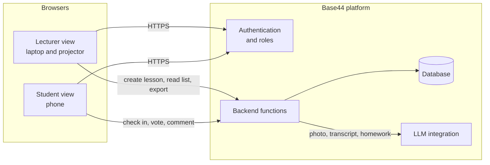
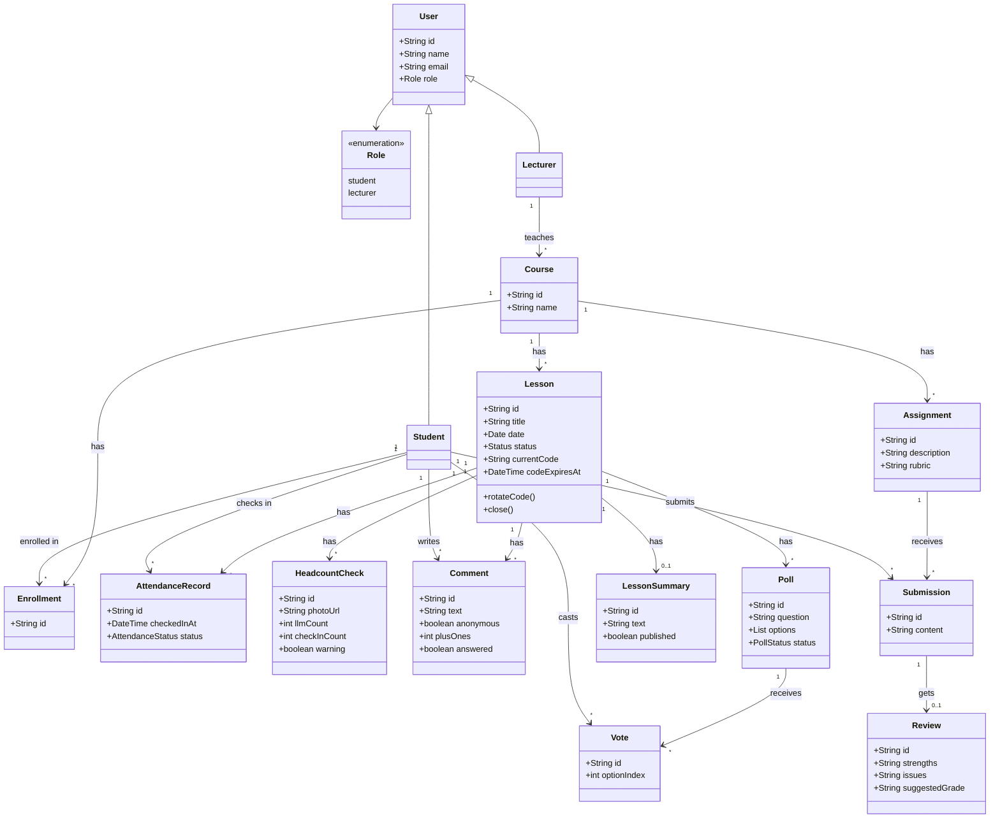
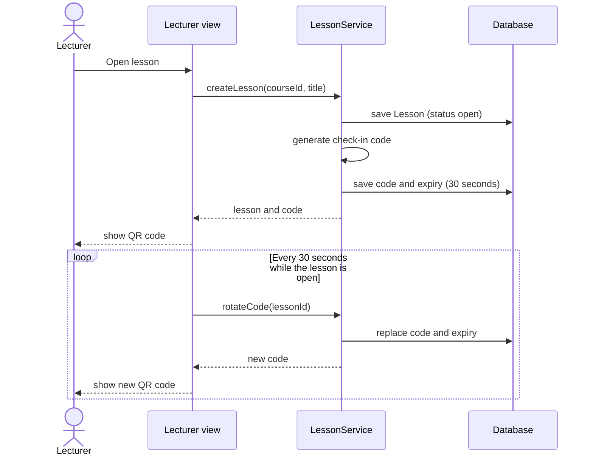
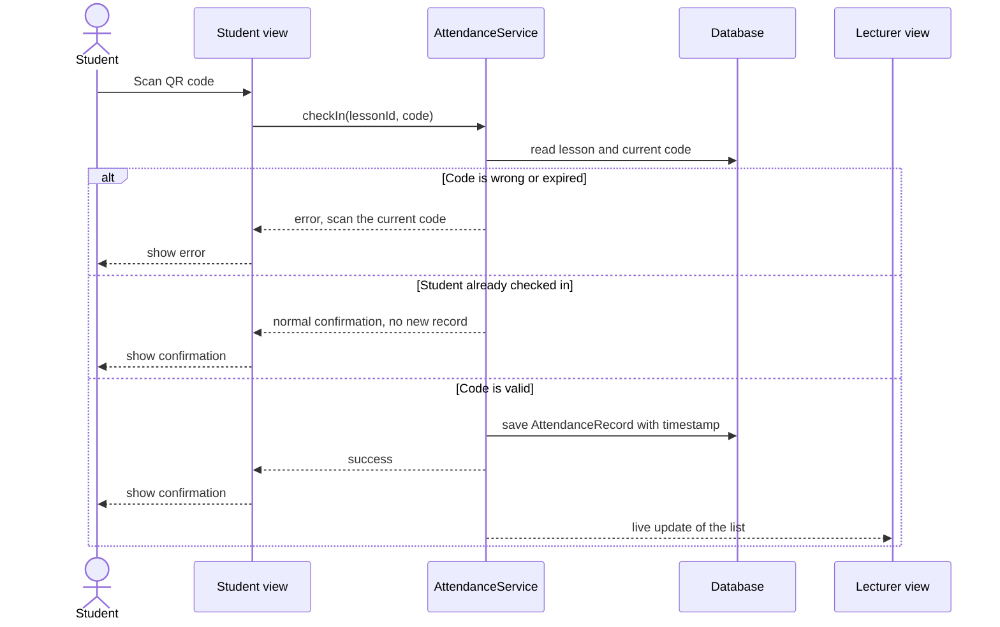
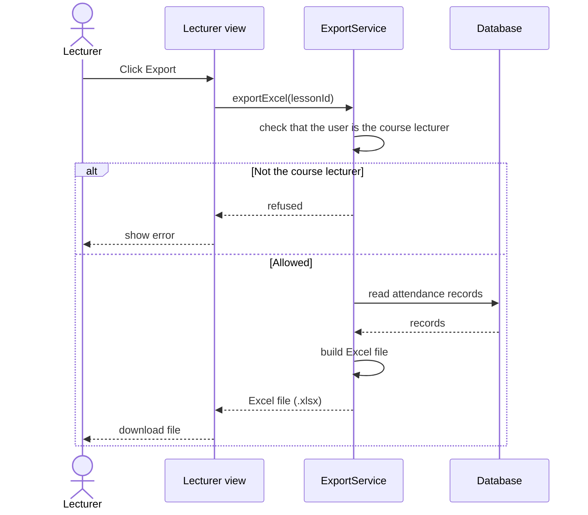
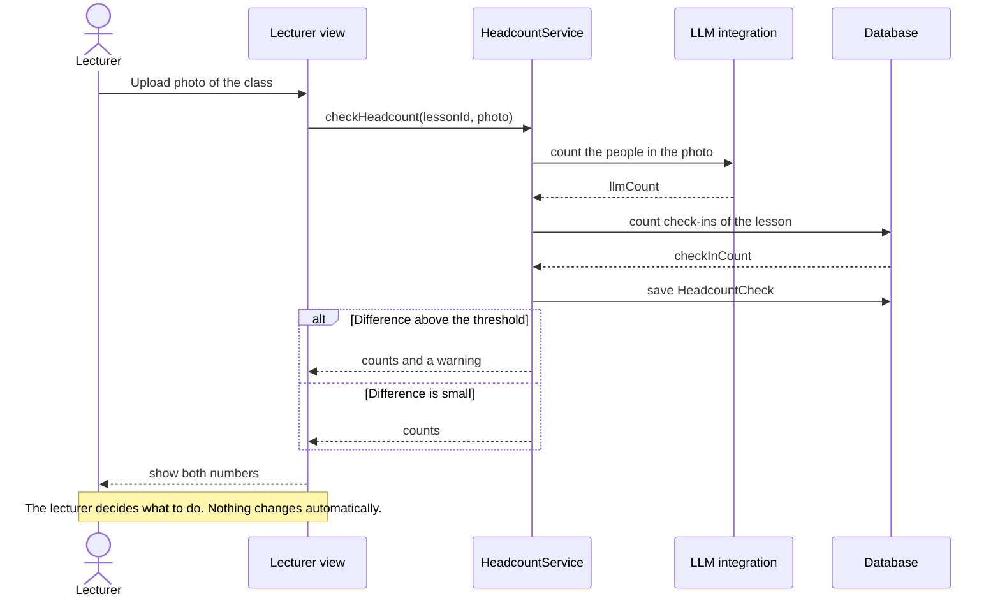
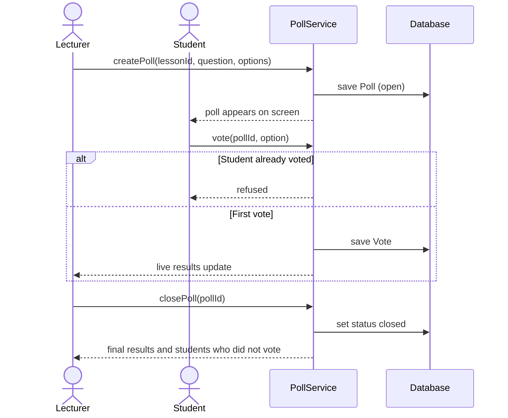

# Architecture: ClassPulse
 
Version 0.1 · 22/11/2026 · Sarah Green, Nerya Azani
 
This document describes the main components of ClassPulse, the classes behind the data, and the sequence of messages in the main use cases. It follows the [SRS](SRS.md) and the [use cases](use-cases.md). The diagrams are written in Mermaid, so GitHub renders them directly.
 
## 1. Overview
 
ClassPulse is a responsive web app. Students use it on a phone, and the lecturer uses it on the laptop that is connected to the projector. The app is built on Base44, which provides the database, login, hosting and the call to the LLM. We do not run a server of our own (see SRS, Constraints).
 
## 2. Components
 

 
### 2.1 Component responsibilities
 
| Component | Responsibility | Features |
|-----------|----------------|----------|
| Lecturer view | Shows the QR code, the live list, the poll results and the LLM suggestions. Starts the export | F1 to F5 |
| Student view | Check-in confirmation, polls, comments, homework | F1 to F5 |
| Authentication and roles | Email login, role choice, the lecturer access code (checked on the server) | FR-1.10 |
| Backend functions | All the rules of the app (see 2.2) | F1 to F5 |
| Database | Stores courses, lessons, attendance, polls, comments and reviews | All |
| LLM integration | Counts people in a photo, summarizes a transcript, reviews homework | F1b, F4, F5 |
 
### 2.2 Backend modules
 
We group the backend functions into modules. Each module has one job, and the classes in section 3 are the data they work on.
 
| Module | Job | Requirements |
|--------|-----|--------------|
| RoleService | Chooses the role, verifies the lecturer code, counts wrong attempts | FR-1.10 |
| CourseService | Creates courses, adds students manually or from a CSV | FR-1.1 |
| LessonService | Opens and closes a lesson, creates the rotating check-in code | FR-1.2, FR-1.3, FR-1.11 |
| AttendanceService | Records a check-in once, lets the lecturer mark or unmark a student | FR-1.4 to FR-1.6, FR-1.13 |
| ExportService | Builds the Excel file (.xlsx) of a lesson or of a course | FR-1.7, FR-1.12 |
| HeadcountService | Sends a photo to the LLM and compares the count to the check-ins | FR-1.8, FR-1.9 |
| PollService | Creates polls, accepts one vote per student, closes polls | FR-3.1 to FR-3.7 |
| FeedbackService | Saves comments, anonymous display, +1 and "answered" | FR-2.1 to FR-2.4 |
| SummaryService | Sends a transcript to the LLM and publishes the summary | FR-4.1 to FR-4.3 |
| HomeworkService | Stores submissions, asks the LLM for a review and a comparison | FR-5.1 to FR-5.5 |
 
## 3. Class diagram
 

 
### 3.1 Rules the classes must follow
 
- An `AttendanceRecord` is unique for a pair of student and lesson, so a second scan creates no duplicate (FR-1.4).
- A `Vote` is unique for a pair of student and poll (FR-3.3).
- A `Comment` with `anonymous = true` is shown without a name. The author is still stored in the database (SRS, Constraints).
- A `Review` is visible only to its own student and to the lecturer (NFR-5).
- Results from the LLM (`llmCount`, `LessonSummary`, `Review`) are suggestions. The lecturer can edit them, and nothing changes automatically (NFR-7).
## 4. Sequence diagrams
 
### 4.1 Open a lesson and rotate the code (UC-3)
 

 
### 4.2 Student checks in (UC-4)
 

 
### 4.3 Export attendance (UC-6)
 

 
### 4.4 Headcount from a photo (UC-7)
 

 
### 4.5 Quick poll (UC-9)
 

 
## 5. Design decisions
 
| Decision | Reason |
|----------|--------|
| The check-in code is valid for 30 seconds, and only the current code is accepted | A photo of the QR sent to a friend stops working quickly (FR-1.3) |
| One lesson record holds the current code and its expiry | Keeps the design simple and fits the platform database |
| The lecturer role is protected by a secret code checked on the server | Students cannot export data or see the full list (NFR-6) |
| LLM calls go through backend functions, not from the browser | The lecturer sees the result first and can correct it (NFR-7) |
| No server of our own | The platform gives us login, database and LLM calls, so we design only what we can build in a week |
 
